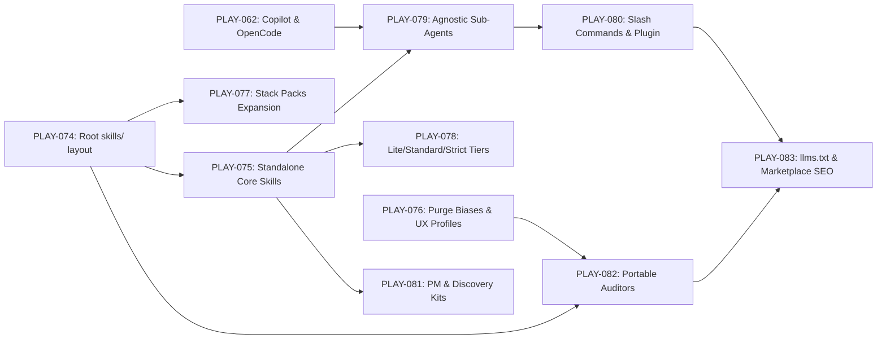

# Gripm Playbook - Market Repositioning Vision & Roadmap

> **North Star:** Transform `@gripm/playbook` from an internal dogfooding governance monolith into an **Open, Modular, Zero-Friction Engineering & Product Superpower Suite** that any developer in any repository can adopt in 5 seconds - across `skills.sh`, Claude Code, Cursor, Windsurf, Copilot, OpenCode, and Antigravity.

---

## 1. Market Diagnosis & Why We Are Repositioning

Benchmarking `@gripm/playbook` against the most downloaded repositories in `skills.sh`, `LinklyAI/best-skills` (`llms.txt` / Worth-Installing Score), `mcpmarket.com`, `awesomeskill.ai`, `agensi.io`, `phuryn/pm-skills`, and `Gentleman-Programming/gentle-ai` revealed structural bottlenecks holding back adoption:

1. **Monolithic "All-or-Nothing" Coupling:** Top skills on `skills.sh` (`find-skills`, `frontend-design`, `vercel-react-best-practices`) are atomic, plug-and-play (`npx skills add owner/repo --skill name`), and exposed at a root `skills/` directory. Our skills currently live under `.agents/skills/` and assume `backlog/tasks/`, `STATE_MACHINE.md`, `npx playbook gate <ID>`, and `@gripm/board`.
2. **Minute-Zero Bureaucracy:** Installing the playbook today injects strict rules (`NON_NEGOTIABLES`, mandatory `backlog/tasks/` tracking for every change, 8-dimension refinement interviews, English-only commits, `dev -> main` ceremony) before delivering immediate developer relief.
3. **Personal Dogfooding Bias:** Core skills and the 20-rule `audit-ux` catalog mix universal web/a11y invariants with idioms born from personal mobile PWA projects (`BottomNav`, `pb-32`, LATAM decimal commas, anti-em-dash), plus Antigravity-only primitives (`invoke_subagent`, `send_message`).
4. **Missing Slash Commands & Narrow Stack Catalog:** Leaders like `phuryn/pm-skills` convert daily traffic through explicit `/commands` (`/discover`, `/refine`, `/verify`) and rich PM/Architecture templates, while `skills.sh` traffic enters through high-demand stacks (`nextjs`, `typescript-strict`, `node-api`, `testing`, `python-api`).
5. **Under-Leveraged Moat:** Almost every skill on `skills.sh` is pure Markdown prose. Gripm Playbook's true differentiator - **zero-dependency, zero-token deterministic AST auditors (`audit-ux`, `audit-repo`, `check-loc`) paired with clean-context Blind QA** - is hidden behind onboarding ceremony instead of leading the funnel.

---

## 2. Strategic Positioning: The Open Funnel

Instead of forcing full backlog governance upfront, `@gripm/playbook` leads with **instant, zero-ceremony value** and scales progressively only when the team wants more structure:

- **Tier 1 (`lite`, New Default for Standalone):** Atomic skills (`npx skills add`), `/slash` commands, deterministic `audit-ux` / `audit-repo` / `check-loc`, and taskless Blind QA on `git diff`. Zero `backlog/tasks/` requirement.
- **Tier 2 (`standard`):** Connects seamlessly with `@gripm/board` (`backlog/tasks/*.md`, local web cockpit, `gripm-mcp` server + persistent project memory).
- **Tier 3 (`strict`):** Full enterprise release gates, worktree leases (`claimed_by`), `--strict` LOC/UX enforcement, and `dev -> main` production promotion.

---

## 3. Strategic Epics & Task Roadmap (`PLAY-074` to `PLAY-083`)

### Epic 1 - Open Atomic Skills & Standalone Core (`epic-1-open-skills`)
Make every Playbook skill discoverable via `npx skills add` and 100% functional without `backlog/tasks/` or `@gripm/board`.

| ID | Title | Priority | Dependencies | Task File |
| :--- | :--- | :--- | :--- | :--- |
| `PLAY-074` | Root `skills/` layout compatible with `skills.sh` and `npx skills add` | `high` | - | [PLAY-074](../backlog/tasks/PLAY-074 - Estructura raiz skills compatible con skills-sh y npx skills add.md) |
| `PLAY-075` | Decouple core skills for Standalone Mode without requiring `backlog/tasks/` or `gripm-board` | `high` | `PLAY-074` | [PLAY-075](../backlog/tasks/PLAY-075 - Desacople de skills core para ejecucion Standalone sin requerir backlog-tasks ni gripm-board.md) |

### Epic 2 - Universal Engineering Core & Stack Expansion (`epic-2-universal-core`)
Remove personal project biases from core rules, modularize `audit-ux` into selectable profiles, and cover high-demand tech stacks.

| ID | Title | Priority | Dependencies | Task File |
| :--- | :--- | :--- | :--- | :--- |
| `PLAY-076` | Purge personal dogfooding biases and modularize `audit-ux` into profiles | `high` | - | [PLAY-076](../backlog/tasks/PLAY-076 - Purga de sesgos de dogfooding personal y modularizacion de audit-ux en perfiles.md) |
| `PLAY-077` | Expand high-demand Stack Packs (`nextjs`, `typescript-strict`, `node-api`, `testing`, `python-api`) | `medium` | `PLAY-074` | [PLAY-077](../backlog/tasks/PLAY-077 - Expansion de Stack Packs de alta demanda en el mercado.md) |

### Epic 3 - Progressive Governance & Frictionless DX (`epic-3-progressive-governance`)
Replace the minute-zero bureaucratic wall with progressive adoption tiers (`lite`, `standard`, `strict`).

| ID | Title | Priority | Dependencies | Task File |
| :--- | :--- | :--- | :--- | :--- |
| `PLAY-078` | Progressive adoption levels in `init` and `AGENTS.md` (`lite`, `standard`, `strict`) | `high` | `PLAY-075` | [PLAY-078](../backlog/tasks/PLAY-078 - Niveles de adopcion progresiva en init y AGENTS-md lite standard y strict.md) |

### Epic 4 - Harness-Agnostic Sub-Agents, Slash Commands & PM Kits (`epic-4-multi-harness`)
Unlock native sub-agents, slash workflows, Claude Code Plugin marketplace installation, and real PM/Architecture frameworks across all AI coding tools.

| ID | Title | Priority | Dependencies | Task File |
| :--- | :--- | :--- | :--- | :--- |
| `PLAY-079` | Harness-agnostic sub-agent abstraction and native multi-harness adapters | `high` | `PLAY-062`, `PLAY-075` | [PLAY-079](../backlog/tasks/PLAY-079 - Abstraccion agnostica de sub-agentes y adaptadores nativos multi-harness.md) |
| `PLAY-080` | Actionable `/slash` command suite and Claude Code Plugin manifest | `high` | `PLAY-075`, `PLAY-079` | [PLAY-080](../backlog/tasks/PLAY-080 - Suite de comandos slash accionables y manifiesto de Plugin para Claude Code.md) |
| `PLAY-081` | Product Discovery and Architecture kits in `pm-orchestrator` and `market-researcher` | `medium` | `PLAY-075` | [PLAY-081](../backlog/tasks/PLAY-081 - Kits de Product Discovery y Arquitectura en pm-orchestrator y market-researcher.md) |

### Epic 5 - Zero-Token Deterministic Packaging & Marketplace Reach (`epic-5-marketplace-growth`)
Turn Gripm's deterministic engines into portable zero-install tools and optimize discovery for `skills.sh`, `LinklyAI/best-skills`, `mcpmarket.com`, and `awesomeskill.ai`.

| ID | Title | Priority | Dependencies | Task File |
| :--- | :--- | :--- | :--- | :--- |
| `PLAY-082` | Portable zero-install packaging for `audit-ux`, `audit-repo`, and `check-loc` via `skills.sh` | `high` | `PLAY-074`, `PLAY-076` | [PLAY-082](../backlog/tasks/PLAY-082 - Empaquetado portable de audit-ux audit-repo y check-loc para ejecucion desde skills-sh.md) |
| `PLAY-083` | Publish `llms.txt` and optimize metadata for `skills.sh` and `LinklyAI` | `high` | `PLAY-074`, `PLAY-080`, `PLAY-082` | [PLAY-083](../backlog/tasks/PLAY-083 - Publicacion de llms-txt y optimizacion de metadatos para skills-sh y LinklyAI.md) |

---

## 4. Execution Dependency Graph

---

## 5. Cross-Repository Companion Roadmap (`@gripm/board`)

While `@gripm/playbook` captures the top of the open-source skill funnel (`npx skills add` + zero-token static auditors), the companion `@gripm/board` repository executes parallel epics (`DEV-371` through `DEV-376`) to provide:
- Persistent Project Decision & Invariant Memory (`gripm_remember` / `gripm_recall`) in `gripm-mcp` and the Web Cockpit.
- Zero-Ceremony `gripm --init` presets aligned with Playbook `lite`/`standard`/`strict` tiers.
- Multi-harness auto-configuration of `.mcp.json`, `.cursor/mcp.json`, and `.vscode/mcp.json`.
- `llms.txt` + `skills/gripm/` packaging + visual Skills & Stack Packs manager inside the cockpit.
